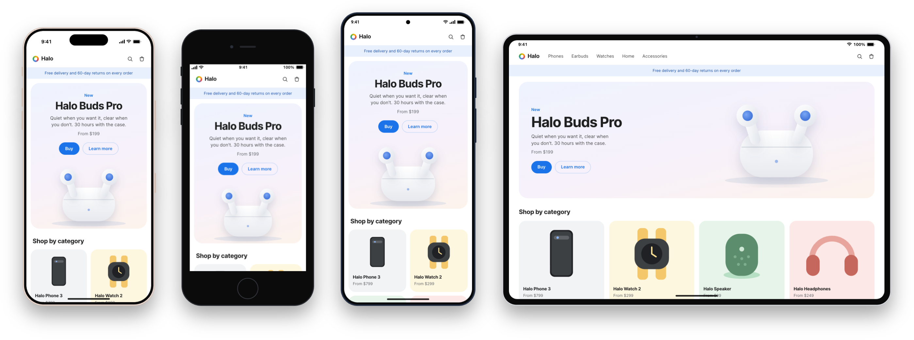
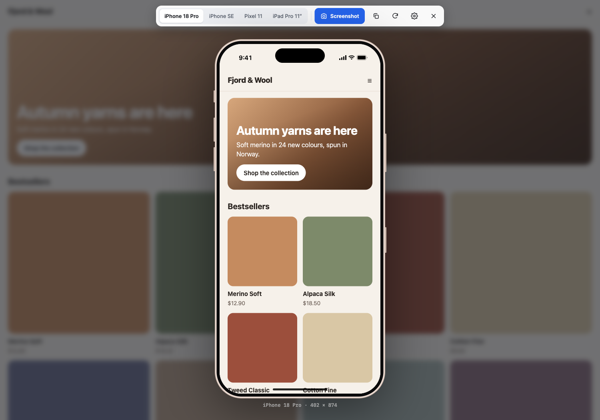

<h1 align="center">Previewer</h1>

  See the page you're on in a phone or tablet frame with one click, and save it as a transparent PNG.
   
  A free, open-source Chrome extension. No account, no tracking, nothing leaves your browser.

  <a href="https://github.com/royandre/previewer/releases/latest/download/previewer.zip"><b>Download the latest release</b></a>
  ·
  <a href="#install">Install</a>
  ·
  <a href="#use">Use</a>
  ·
  <a href="CONTRIBUTING.md">Contribute</a>

  

## Why

Chrome's device mode is built for debugging. Previewer is built for looking: one click puts the page you're on into a
realistic phone, you flip between a few devices that matter, and you save a clean picture for a slide, a pull request or
a message to a client.

## Install

Previewer is installed from GitHub for now.

1. [Download `previewer.zip`](https://github.com/royandre/previewer/releases/latest/download/previewer.zip) and unzip it.
2. Open `chrome://extensions` and switch on **Developer mode** (top right).
3. Click **Load unpacked** and pick the unzipped folder.
4. Pin Previewer from the puzzle-piece menu so the button is always one click away.

To update, download the new zip, replace the folder's contents, and click the reload icon on the extension's card in
`chrome://extensions`. Built for Chrome 120 or newer. Other Chromium browsers (Edge, Brave, Arc) should work but aren't
tested yet.

## Use

Click the Previewer button, or press <kbd>Alt</kbd>+<kbd>Shift</kbd>+<kbd>P</kbd>. The page opens inside a phone on top
of the tab. Click again, or press <kbd>Esc</kbd>, to close it.

| Shortcut (Mac / Windows and Linux)                    | What it does                                  |
| ----------------------------------------------------- | --------------------------------------------- |
| <kbd>⌘1</kbd>–<kbd>⌘4</kbd> / <kbd>Ctrl+1</kbd>–<kbd>Ctrl+4</kbd> | Switch device                     |
| <kbd>⌘S</kbd> / <kbd>Ctrl+S</kbd>                     | Save a screenshot to Downloads                |
| <kbd>⌘C</kbd> / <kbd>Ctrl+C</kbd>                     | Copy the screenshot (paste it into Slack, Figma, Keynote …) |
| <kbd>Esc</kbd>                                        | Close                                         |

The shortcuts work in the toolbar and inside the page in the phone. <kbd>⌘C</kbd> still copies text if you have text
selected. Change the open shortcut at `chrome://extensions/shortcuts`.

### Devices

| Device        | Viewport (CSS px) | Why it's here                                                       |
| ------------- | ----------------- | ------------------------------------------------------------------- |
| iPhone 18 Pro | 402 × 874         | The current iPhone.                                                 |
| iPhone SE     | 375 × 667         | The smallest and shortest screen in common use: shows what falls below the fold. |
| Pixel 11      | 412 × 924         | The current Pixel, and the typical Android width.                   |
| iPad Pro 11″  | 834 × 1210        | Tablet layout. Like Safari on iPad, it asks for the desktop site.    |

Switching device keeps your place on the page. The page reloads only when you click the reload button.

### Settings

Click the gear in the toolbar.

- **Status bar.** Clock, signal and battery at the top. The bar takes the page's `theme-color` (or background), like a
  real phone.
- **Frame in screenshot.** On by default. Turn it off to save only the screen.
- **Shadow in screenshot.** Off by default. Adds a soft shadow around the frame in the PNG.

Settings and the last device you used are remembered.

### Screenshots

Screenshots are PNG files with a transparent background, so they sit cleanly on any slide or page. They capture what is
visible on the phone's screen, at your monitor's resolution: on a Retina or other high-density screen that is about 2×
the device's CSS size. Files are named `<site>-<device>-<date>-<time>.png`.

## What it does and doesn't emulate

Previewer loads the page again in a frame that is exactly the device's width, so media queries, responsive images and
layout behave like on the phone. It also sends the device's User-Agent and client hints, so sites that serve separate
mobile HTML do so.

Some things stay desktop Chrome, because changing them would need the `debugger` permission and a "Chrome is being
controlled" banner on every page:

- `navigator.userAgent` in JavaScript still reports desktop Chrome. Server-side detection works; client-side sniffing
  doesn't.
- Touch: inside the phone the mouse pointer becomes a fingertip, but it is still a mouse. Hover effects still work,
  `(hover: hover)` and `(pointer: fine)` still match, and you scroll with a mouse wheel or trackpad.
- The rendering engine is Chrome's Blink, not Safari's WebKit. Previewer shows layout, not WebKit-specific bugs.

If a link inside the phone leads to a different website that refuses to be shown in a frame, Chrome shows its own
"refused to connect" page. Open that site directly and click Previewer there.

## Permissions and privacy

Previewer does nothing until you click it, and then only on that tab.

| Permission                          | Why                                                                                     |
| ----------------------------------- | --------------------------------------------------------------------------------------- |
| `activeTab`                         | Access to the current tab only when you click the button or use the shortcut.           |
| `scripting`                         | Show the phone on top of that tab.                                                      |
| `declarativeNetRequestWithHostAccess` | While the preview is open, in that tab only: send the phone's User-Agent, and remove the headers that stop sites from being shown in a frame (`X-Frame-Options` and `Content-Security-Policy`). The rule is removed when you close the preview or leave the page. |
| `storage`                           | Remember your device and settings.                                                      |

There is no standing access to websites, no background content scripts, no network requests of its own, and no
analytics. See [PRIVACY.md](PRIVACY.md).

Because the page's Content-Security-Policy is removed inside the preview, treat the preview like a development tool:
don't use it to log in to sites you don't trust.

## Contributing

Bug reports, device updates and pull requests are welcome. Start with [CONTRIBUTING.md](CONTRIBUTING.md). Device sizes
and colours live in one file, [`extension/devices.json`](extension/devices.json), so fixing or adding a device rarely
needs code.

## License

[MIT](LICENSE). iPhone and iPad are trademarks of Apple Inc. Pixel is a trademark of Google LLC. Previewer is not
affiliated with either; the device frames are drawn from scratch.
